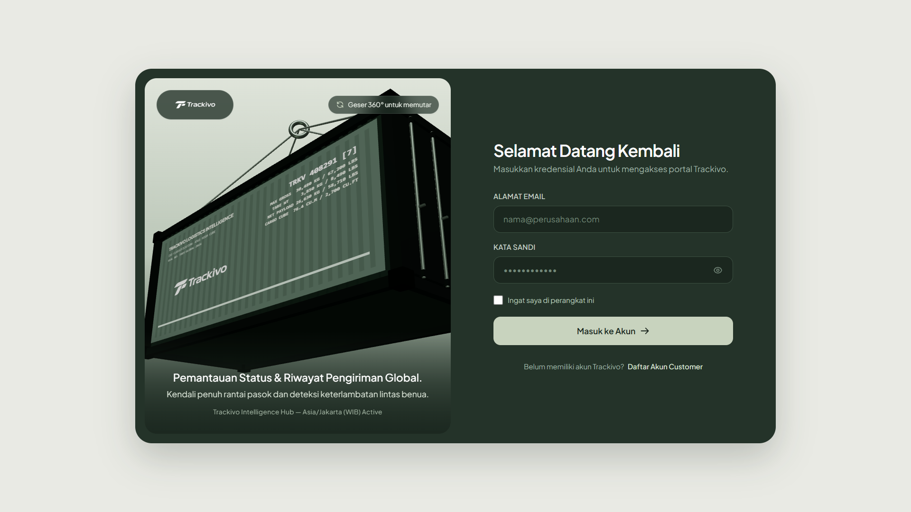
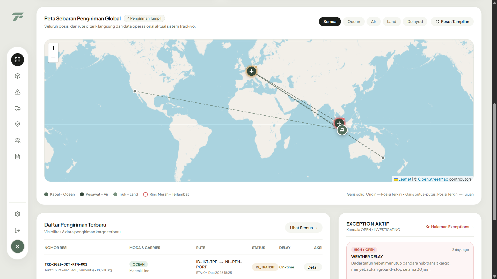
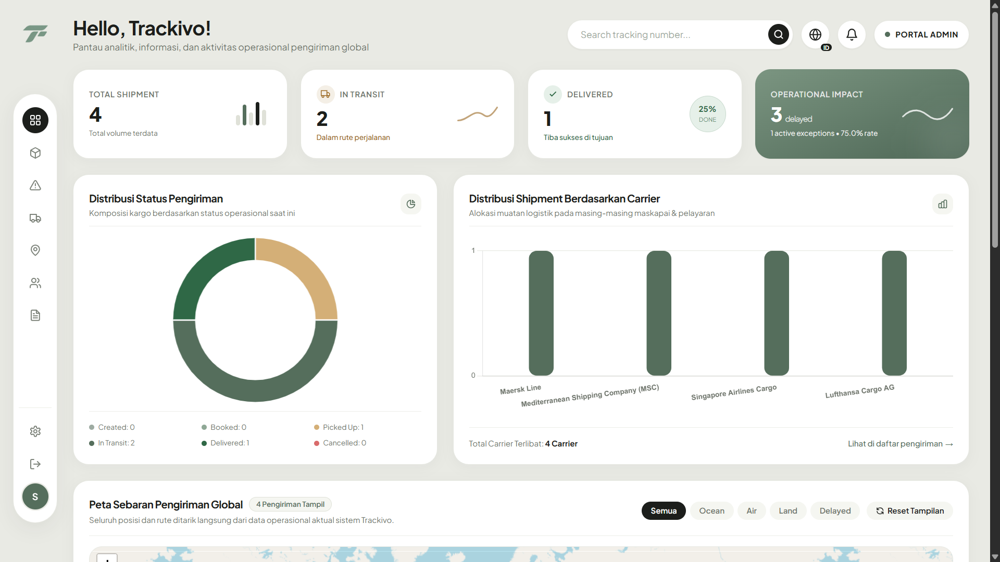
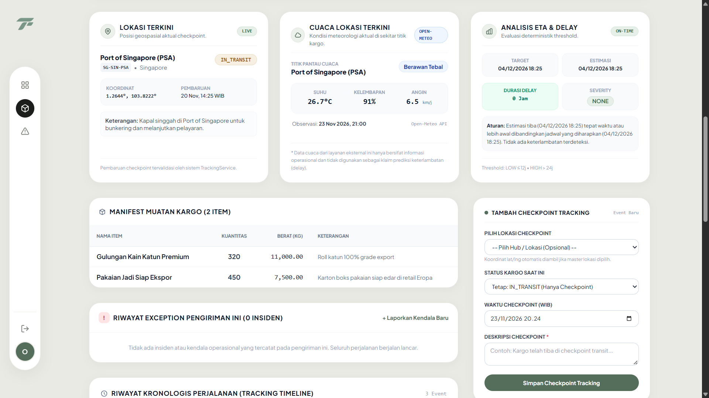
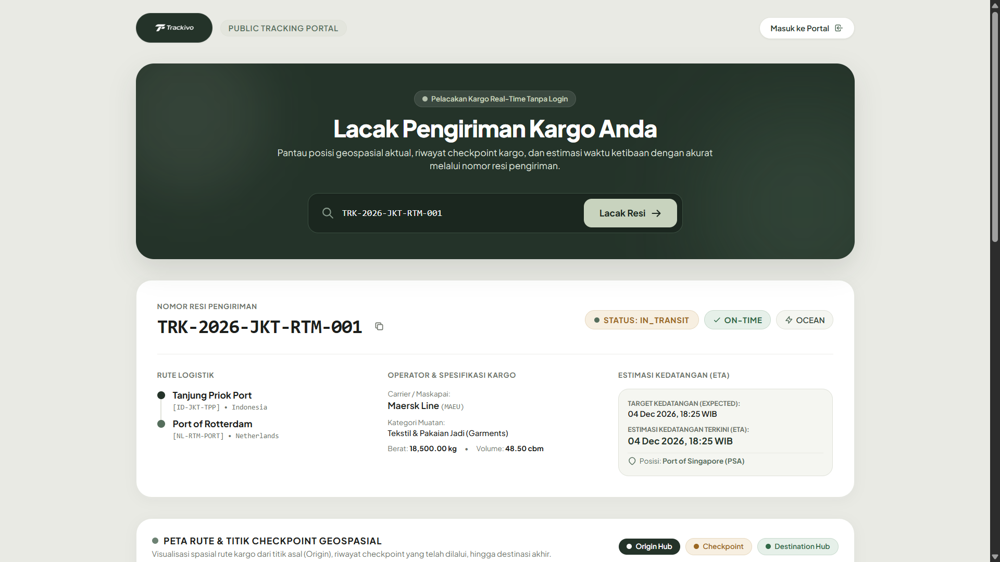
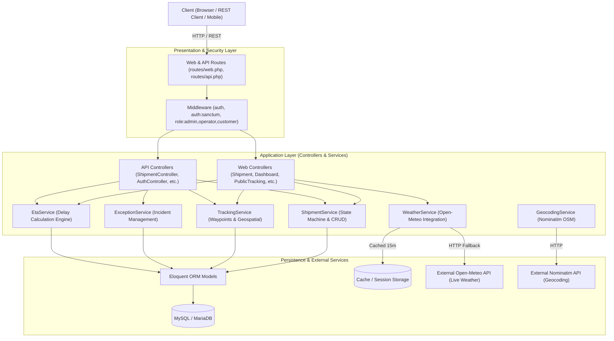
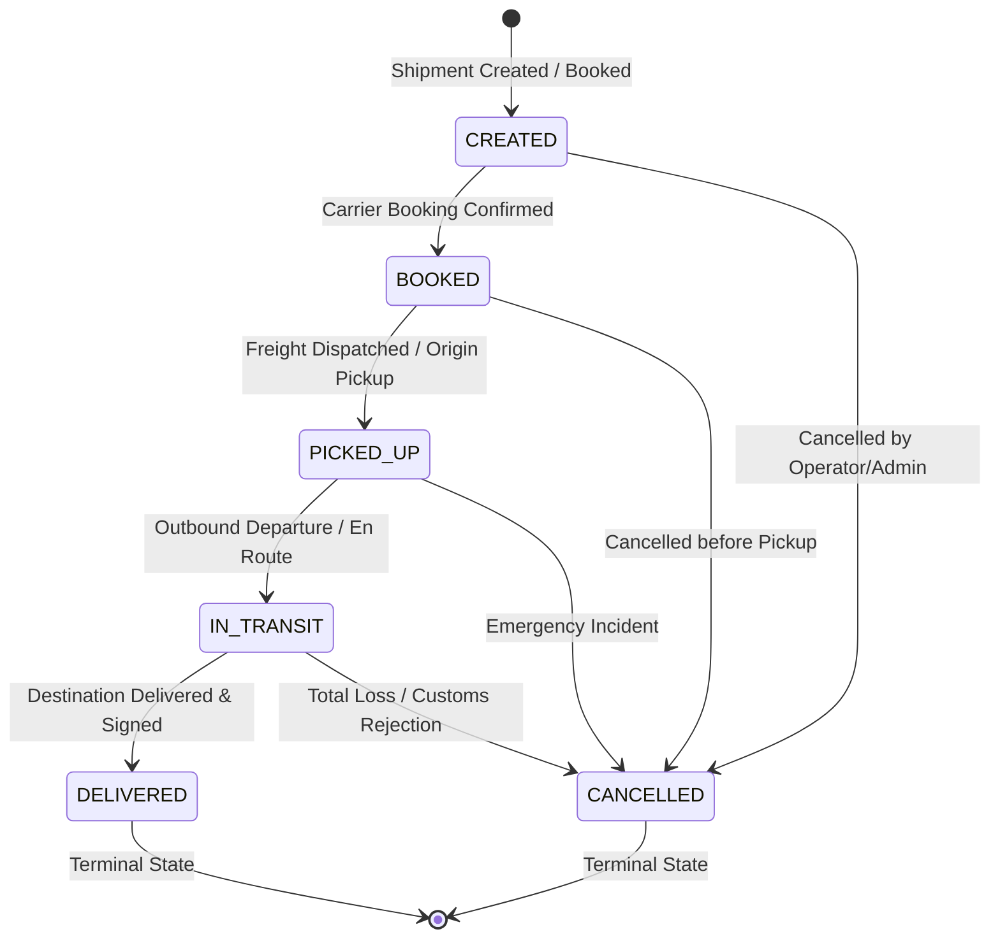

# Trackivo — Global Shipment Visibility & Tracking Platform

[](https://laravel.com)
[](https://php.net)
[](https://tailwindcss.com)
[](https://mariadb.org)
[](https://leafletjs.com)
[](https://threejs.org)
[](https://laravel.com/docs/sanctum)
[](tests)

> **Trackivo** is an enterprise-grade multimodal freight visibility and shipment tracking platform built with Laravel 13. It empowers logistics control towers, global shippers, and freight forwarders with real-time consignment milestone tracking, interactive geospatial routing, deterministic delay impact analytics, weather telemetry, and secure token-based REST APIs.

---

## Table of Contents
- [Problem Statement & Solution](#problem-statement--solution)
- [Key Features](#key-features)
- [Visual Showcase](#visual-showcase)
- [System Architecture & State Machine](#system-architecture--state-machine)
- [Tech Stack](#tech-stack)
- [Local Installation & Setup Guide](#local-installation--setup-guide)
- [Demo Accounts](#demo-accounts)
- [Technical Documentation](#technical-documentation)
- [Testing & Test Evidence](#testing--test-evidence)
- [Live Deployment](#live-deployment)
- [Known Limitations & Future Work](#known-limitations--future-work)
- [Attribution & Third-Party Libraries](#attribution--third-party-libraries)
- [Author & License](#author--license)

---

## Problem Statement & Solution

### The Challenge
Global supply chain operations frequently suffer from fragmented data silos, blind transit segments across multimodal legs (Ocean, Air, Land), unpredictable transit delays, and cumbersome exception resolution. Shippers and consignees are often left unaware of customs holds, port congestion, or inclement weather until delivery deadlines are breached.

### The Trackivo Solution
Trackivo bridges this gap by offering:
1. **Single Source of Truth:** Centralizes multimodal shipments under unified tracking numbers (`TRK-YYYY-XXXXXX`).
2. **Proactive Exception Management:** Captures disruptions (customs hold, port congestion, weather delay) with immediate delay impact evaluation and resolution audit logs.
3. **Geospatial & Environmental Intelligence:** Plots interactive journey paths on OpenStreetMap and pulls live meteorological telemetry via the Open-Meteo API.
4. **Deterministic ETA Engine:** Dynamically calculates estimated arrivals and categorizes delay severity based on configurable operational thresholds.
5. **Modern Immersive Experience:** Features interactive 3D cargo container authorization, an organic Sage & Sand design system, and multi-language support (English & Indonesian).

---

## Key Features

- **Multi-Role Access Control (RBAC):**
  - **Administrator:** Complete oversight of master data (carriers, geographic facilities), user management, global delay thresholds, and immutable audit logs.
  - **Logistics Operator:** Daily control tower operations, cargo booking, state transitions, milestone checkpoint logging, and exception handling.
  - **Customer:** Secure access restricted strictly to their own shipments, consignment item manifests, and timeline updates.
  - **Public Tracking Portal (`/track`):** Publicly accessible, unauthenticated tracking portal allowing consignees to check status using their tracking number.

- **Operational State Machine & Strict Validation:**
  - Manages consignment progression through predefined states: `CREATED` &rarr; `BOOKED` &rarr; `PICKED_UP` &rarr; `IN_TRANSIT` &rarr; `DELIVERED` (or `CANCELLED`).
  - Strict server-side enforcement prevents invalid backward or skipped transitions, backed by comprehensive database audit logging.

- **Deterministic ETA & Delay Threshold Analysis:**
  - Compares contractual baseline arrivals against dynamic ETAs.
  - Configurable threshold engine automatically categorizes delay severity into `NONE`, `LOW`, `MEDIUM`, or `HIGH`.

- **Interactive Geospatial Maps & Live Weather Telemetry:**
  - Visualizes origin, checkpoints, current coordinates, and destination hubs via **Leaflet.js** and **OpenStreetMap**.
  - Fetches real-time temperature, wind speed, humidity, and weather conditions at the consignment's current coordinate using **Open-Meteo API** (with 15-minute caching and graceful fallback handling).

- **Interactive 3D Authentication & Sage-Sand Design System:**
  - **Three.js** interactive 3D shipping container with realistic materials, shadows, and **OrbitControls** on login and registration pages.
  - Natural **Sage & Sand** palette paired with Tailwind CSS v4 for reduced visual fatigue in control tower environments.
  - Instant client-side English / Indonesian localization switcher.

- **Token-Based REST API & Automated Testing:**
  - Full REST API powered by **Laravel Sanctum Bearer tokens**.
  - Automated test suite comprising **57 automated tests** and **277 assertions** ensuring zero regression.

---

## Visual Showcase

### 1. Interactive 3D Cargo Authentication

*Interactive 3D intermodal cargo container rendered with Three.js, dynamic lighting, and orbital camera interaction on the authentication portal.*

---

### 2. Control Tower Geospatial Operations Map

*Global fleet map powered by Leaflet.js and OpenStreetMap displaying active shipments, origin-destination routes, and status pins.*

---

### 3. Logistics Analytics & Delay Monitoring

*Key operational metrics, delay severity distribution, active exceptions counter, and quick-filter control tower tables.*

---

### 4. Shipment Detail, Checkpoints & Weather Telemetry

*Consignment deep-dive detailing package manifests, route timeline, live coordinate weather, and state transition actions.*

---

### 5. Public Shipment Tracking Portal (`/track`)

*Publicly accessible tracking portal for end customers and consignees to verify transit milestones in real time.*

---

## System Architecture & State Machine

### High-Level System Architecture


---

### Operational State Machine
Consignments transition through a strict, deterministic finite state machine validated both at the service layer and database constraints:



---

## Tech Stack

| Domain | Technology / Library | Version / Specifications | Role in Trackivo |
| :--- | :--- | :--- | :--- |
| **Backend Framework** | [Laravel](https://laravel.com) | `13.x` | Enterprise MVC application core, routing, Eloquent ORM, service container. |
| **Runtime Environment** | [PHP](https://php.net) | `^8.3` (Tested on PHP 8.5) | Server-side execution engine with strict type declarations. |
| **API Authentication** | [Laravel Sanctum](https://laravel.com/docs/sanctum) | `^4.5` | Stateless token-based REST API authentication and role scoping. |
| **Relational Database** | [MySQL](https://mysql.com) / [MariaDB](https://mariadb.org) | 8.0+ / 10.4+ | Persistent storage with foreign key constraints, composite indexes, and ACID transactions. |
| **Frontend Styling** | [Tailwind CSS](https://tailwindcss.com) | `v4.0` | High-performance CSS framework implementing the custom Sage & Sand design language. |
| **Asset Bundler** | [Vite](https://vitejs.dev) | `v8.0` | Rapid ESM-powered asset compilation and hot module reloading. |
| **Geospatial Mapping** | [Leaflet.js](https://leafletjs.com) | `1.9.4` | Interactive mobile-friendly map projections with OpenStreetMap tiles. |
| **3D Rendering** | [Three.js](https://threejs.org) + OrbitControls | `r128` | WebGL 3D shipping container rendering on authentication screens. |
| **Motion & Animation** | [GSAP](https://greensock.com/gsap/) | `3.12` | Fluid control tower timeline and badge animations. |
| **Data Visualization** | [Chart.js](https://chartjs.org) | `4.4` | Analytics charts for delay distribution, modal split, and volume trends. |
| **Weather Telemetry** | [Open-Meteo API](https://open-meteo.com) | REST API | Coordinate-based real-time meteorological data with fail-safe caching. |
| **Geocoding API** | [Nominatim OSM](https://nominatim.openstreetmap.org) | REST API | Autocomplete geocoding service for logistic hub coordinate resolution. |
| **Automated Testing** | [PHPUnit](https://phpunit.de) | `12.5` | Feature, Unit, State Machine, and API security test suite. |

---

## Local Installation & Setup Guide

Follow these steps to run Trackivo on your local development machine:

### Prerequisites
- **PHP:** Version `8.3` or higher (ensure `pdo_mysql`, `curl`, `mbstring`, `openssl`, and `gd` extensions are enabled).
- **Composer:** Version `2.x`.
- **Database Server:** MySQL 8.0+ or MariaDB 10.4+ (such as provided by XAMPP, Laragon, or Docker).
- **Git:** Installed and available in your CLI.

---

### Step-by-Step Installation

#### 1. Clone the Repository
```bash
git clone https://github.com/Ghufran-cmyk/Trackivo.git
cd Trackivo
```

#### 2. Install PHP Dependencies
```bash
composer install
```

#### 3. Environment Configuration
Copy the template configuration file:
```bash
cp .env.example .env
```
Generate an application encryption key:
```bash
php artisan key:generate
```

#### 4. Configure Database Connection
Ensure MySQL/MariaDB service is running. Open `.env` and configure your database parameters:
```env
DB_CONNECTION=mysql
DB_HOST=127.0.0.1
DB_PORT=3306
DB_DATABASE=trackivo_db
DB_USERNAME=root
DB_PASSWORD=
```
Create the database `trackivo_db` in your MySQL management tool (e.g. phpMyAdmin, MySQL Workbench, or CLI):
```sql
CREATE DATABASE trackivo_db CHARACTER SET utf8mb4 COLLATE utf8mb4_unicode_ci;
```

#### 5. Run Database Migrations & Seeders
Execute database migrations and populate demo accounts, carriers, multimodal hubs, and sample shipments:
```bash
php artisan migrate --seed
```

#### 6. Run the Application
Start the local development server:
```bash
php artisan serve
```
Open your browser and navigate to:
```http
http://127.0.0.1:8000
```
To access the public tracking portal without logging in:
```http
http://127.0.0.1:8000/track
```

#### 7. Run the Automated Test Suite
Verify that all 57 automated tests pass:
```bash
php artisan test
```

---

## Demo Accounts

The database seeder provisions four pre-configured accounts representing each system role:

| Role | Name | Email Address | Password | Access Privileges & Scope |
| :--- | :--- | :--- | :--- | :--- |
| **Administrator** | System Administrator | `admin@trackivo.com` | `password` | Full system access: manage carriers, locations, user accounts, delay threshold settings, audit logs, and shipment purge. |
| **Logistics Operator** | Operations Specialist | `operator@trackivo.com` | `password` | Operational access: create shipments, advance state machine, log tracking events, report and resolve exceptions. |
| **Customer** | Budi Santoso | `customer1@trackivo.com` | `password` | Consignee portal: view only personal consignments (`PT Nusantara Logistik`), cargo items, and transit timeline. |
| **Customer** | Elena Vance | `customer2@trackivo.com` | `password` | International consignee portal: view personal consignments (`Pacific Trade Co.`). |

---

## Technical Documentation

Detailed architectural and developer specifications are maintained in the `docs/` directory:

-  **[Database Architecture & Data Dictionary (docs/DATABASE.md)](docs/DATABASE.md)**
  Complete Entity-Relationship Diagram (ERD), table structures, column definitions, data types, indexes, and referential integrity constraints.

-  **[REST API Documentation (docs/API.md)](docs/API.md)**
  Comprehensive API specification for all authentication, shipment, tracking, exception, carrier, and location endpoints with cURL samples and JSON responses.

-  **[Postman Collection (docs/Trackivo_API.postman_collection.json)](docs/Trackivo_API.postman_collection.json)**
  Postman v2.1 collection pre-configured with environment variables (`base_url`, `token`), automated token extraction scripts, and sample payloads.

---

## Testing & Test Evidence

Trackivo emphasizes stability through a comprehensive PHPUnit automated test suite covering:
- **Role-Based Authorization:** Validates endpoint access and restrictions across Admin, Operator, and Customer roles.
- **Finite State Machine:** Tests legal state transitions, terminal state immutability, and illegal jump rejections.
- **Deterministic ETA & Delay Engine:** Validates delay hours calculation and severity classification against threshold configurations.
- **REST API Endpoints:** Validates request sanitization, response formatting, and Sanctum token authentication.

### Test Execution Command
```bash
php artisan test
```

### Actual Test Results
```text
PHPUnit 12.5.45 by Sebastian Bergmann and contributors.

   PASS  Tests\Unit\ExampleTest
   PASS  Tests\Unit\EtaServiceTest
   PASS  Tests\Feature\ExampleTest
   PASS  Tests\Feature\AuthTest
   PASS  Tests\Feature\ShipmentStateMachineTest
   PASS  Tests\Feature\ShipmentApiTest
   PASS  Tests\Feature\ExceptionWorkflowTest
   PASS  Tests\Feature\PublicTrackingTest
   PASS  Tests\Feature\AuditLogTest

  Tests:    57 passed (277 assertions)
  Duration: 2.35s
```
**Test Pass Rate:** **100% (57/57 tests passed, 277 assertions verified).**

---

## Live Deployment

Trackivo is designed for seamless containerization and cloud hosting on modern LEMP / PaaS infrastructures:

- **Deployment Status:** Production-Ready
- **Live Demo URL:** `https://trackivo.demo.app` *(Placeholder — easily updated upon cloud deployment)*
- **Recommended Stack:** Nginx + PHP 8.3-FPM + MySQL 8.0 + Redis (for queue & session caching) + SSL Certificate (Let's Encrypt).

---

## Known Limitations & Future Work

### Current System Boundaries
1. **Synthetic Demonstration Telemetry:** Geolocation coordinates and checkpoint waypoints are operator-logged or pre-seeded; physical IoT GPS tracking collars or AIS vessel beacons are not integrated.
2. **Mock Customs & EDI Feeds:** Customs hold events are simulated within the exception management workflow rather than connected to live national customs EDI gateways.
3. **Non-Transactional Financials:** Freight rates and financial settlement gateways (e.g. Stripe, Midtrans) are not included, keeping the focus strictly on logistics visibility and physical freight tracking.

### Future Roadmap
- [ ] **Webhook Subscriptions:** Allow customer ERP/WMS platforms to subscribe to real-time webhook event feeds for milestone events.
- [ ] **Outbound Notifications:** Automated dispatch of email (SMTP) and SMS (Twilio/WhatsApp) alerts for high-severity delays.
- [ ] **Docker Compose & CI/CD Pipeline:** Bundled `docker-compose.yml` and GitHub Actions workflow for automated testing and container deployment.
- [ ] **Barcode & QR Code Scanning:** In-app mobile camera scanner for rapid waypoint logging by warehouse ground operators.

---

## Attribution & Third-Party Libraries

Trackivo is built upon open-source software and open data services:
- **[Laravel Framework](https://laravel.com)** & **[Laravel Sanctum](https://laravel.com/docs/sanctum)** — Taylor Otwell and the Laravel Team.
- **[Tailwind CSS](https://tailwindcss.com)** — Tailwind Labs Inc.
- **[Leaflet.js](https://leafletjs.com)** — Vladimir Agafonkin and contributors.
- **[OpenStreetMap](https://www.openstreetmap.org)** — &copy; OpenStreetMap contributors, licensed under the Open Database License (ODbL).
- **[Open-Meteo API](https://open-meteo.com)** — Open-Meteo weather forecast API under CC BY 4.0.
- **[Three.js](https://threejs.org)** — Ricardo Cabello (Mr.doob) and contributors.
- **[GSAP (GreenSock Animation Platform)](https://greensock.com/gsap/)** — GreenSock.
- **[Chart.js](https://chartjs.org)** — Chart.js contributors.

---

## Author & License

- **Author:** Ghufran Fadlurrahman
- **GitHub Profile:** [@Ghufran-cmyk](https://github.com/Ghufran-cmyk)
- **Repository:** [https://github.com/Ghufran-cmyk/Trackivo](https://github.com/Ghufran-cmyk/Trackivo)
- **Project Scope:** Final Project / Portfolio Examination (UAS)

This project is open-sourced software licensed under the **[MIT License](LICENSE)**.
