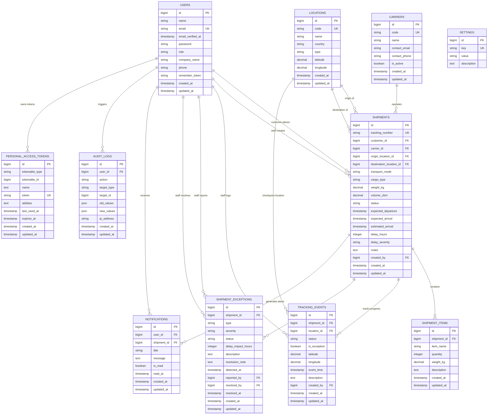

# Trackivo Database Architecture & Schema Dictionary

This document provides a comprehensive overview of the database design, entity relationships, schema definitions, and index strategies for **Trackivo — Global Shipment Visibility & Tracking Platform**.

---

## 1. Entity-Relationship Diagram (ERD)

The following Mermaid diagram outlines the relational structure of Trackivo's core entities.

---

## 2. Relational Schema & Cardinality Summary

| Parent Entity | Relationship | Child Entity | Foreign Key Column | On Delete Action |
| :--- | :---: | :--- | :--- | :--- |
| `users` | One-to-Many | `shipments` | `shipments.customer_id` | `CASCADE` |
| `users` | One-to-Many | `shipments` | `shipments.created_by` | `RESTRICT` |
| `users` | One-to-Many | `tracking_events` | `tracking_events.created_by` | `RESTRICT` |
| `users` | One-to-Many | `shipment_exceptions` | `shipment_exceptions.reported_by` | `RESTRICT` |
| `users` | One-to-Many | `shipment_exceptions` | `shipment_exceptions.resolved_by` | `SET NULL` |
| `users` | One-to-Many | `notifications` | `notifications.user_id` | `CASCADE` |
| `users` | One-to-Many | `audit_logs` | `audit_logs.user_id` | `SET NULL` |
| `users` | One-to-Many (Morph) | `personal_access_tokens` | `tokenable_id` + `tokenable_type` | `CASCADE` |
| `carriers` | One-to-Many | `shipments` | `shipments.carrier_id` | `RESTRICT` |
| `locations` | One-to-Many | `shipments` (Origin) | `shipments.origin_location_id` | `RESTRICT` |
| `locations` | One-to-Many | `shipments` (Destination) | `shipments.destination_location_id` | `RESTRICT` |
| `locations` | One-to-Many | `tracking_events` | `tracking_events.location_id` | `SET NULL` |
| `shipments` | One-to-Many | `shipment_items` | `shipment_items.shipment_id` | `CASCADE` |
| `shipments` | One-to-Many | `tracking_events` | `tracking_events.shipment_id` | `CASCADE` |
| `shipments` | One-to-Many | `shipment_exceptions` | `shipment_exceptions.shipment_id` | `CASCADE` |
| `shipments` | One-to-Many | `notifications` | `notifications.shipment_id` | `SET NULL` |

---

## 3. Data Dictionary

### 3.1. `users` Table
Stores user credentials, contact details, and application roles.

| Column | Data Type | Constraints & Indexes | Default | Description |
| :--- | :--- | :--- | :--- | :--- |
| `id` | `BIGINT UNSIGNED` | Primary Key, Auto Increment | None | Unique internal user identifier. |
| `name` | `VARCHAR(255)` | Not Null | None | Full legal or business contact name. |
| `email` | `VARCHAR(255)` | Unique Index, Not Null | None | User's unique login email address. |
| `email_verified_at` | `TIMESTAMP` | Nullable | `NULL` | Timestamp when user confirmed their email. |
| `password` | `VARCHAR(255)` | Not Null | None | Bcrypt-hashed password. |
| `role` | `ENUM` | `('admin','operator','customer')`, Index, Not Null | `'customer'` | System access role determining privileges. |
| `company_name` | `VARCHAR(255)` | Nullable | `NULL` | Business organization or company affiliation. |
| `phone` | `VARCHAR(255)` | Nullable | `NULL` | Primary international phone number. |
| `remember_token` | `VARCHAR(100)` | Nullable | `NULL` | Session persistence remember-me token. |
| `created_at` | `TIMESTAMP` | Nullable | `NULL` | Record creation timestamp. |
| `updated_at` | `TIMESTAMP` | Nullable | `NULL` | Record last modification timestamp. |

---

### 3.2. `carriers` Table
Stores registered freight transport carriers and logistics operators.

| Column | Data Type | Constraints & Indexes | Default | Description |
| :--- | :--- | :--- | :--- | :--- |
| `id` | `BIGINT UNSIGNED` | Primary Key, Auto Increment | None | Unique carrier identifier. |
| `code` | `VARCHAR(255)` | Unique Index, Not Null | None | Standard carrier code (e.g. `MAEU`, `MSCU`, `SIA`). |
| `name` | `VARCHAR(255)` | Not Null | None | Full commercial carrier brand name. |
| `contact_email` | `VARCHAR(255)` | Not Null | None | Carrier operational dispatch email address. |
| `contact_phone` | `VARCHAR(255)` | Not Null | None | Carrier dispatch contact phone number. |
| `is_active` | `BOOLEAN` | Not Null | `true` | Carrier status flag for active booking selection. |
| `created_at` | `TIMESTAMP` | Nullable | `NULL` | Record creation timestamp. |
| `updated_at` | `TIMESTAMP` | Nullable | `NULL` | Record last modification timestamp. |

---

### 3.3. `locations` Table
Stores multimodal hubs, seaports, airports, customs checkpoints, and distribution warehouses with geographic coordinates.

| Column | Data Type | Constraints & Indexes | Default | Description |
| :--- | :--- | :--- | :--- | :--- |
| `id` | `BIGINT UNSIGNED` | Primary Key, Auto Increment | None | Unique location identifier. |
| `code` | `VARCHAR(255)` | Unique Index, Not Null | None | IATA/UN/LOCODE or facility code (e.g., `IDTPP`, `SGSIN`). |
| `name` | `VARCHAR(255)` | Not Null | None | Full geographical facility name. |
| `country` | `VARCHAR(255)` | Not Null | None | Country name or ISO code. |
| `type` | `ENUM` | `('PORT','AIRPORT','WAREHOUSE','CHECKPOINT')`, Not Null | None | Facility categorization for routing logic. |
| `latitude` | `DECIMAL(10, 7)` | Not Null | None | WGS84 latitude coordinate (-90.0000000 to +90.0000000). |
| `longitude` | `DECIMAL(10, 7)` | Not Null | None | WGS84 longitude coordinate (-180.0000000 to +180.0000000). |
| `created_at` | `TIMESTAMP` | Nullable | `NULL` | Record creation timestamp. |
| `updated_at` | `TIMESTAMP` | Nullable | `NULL` | Record last modification timestamp. |

---

### 3.4. `shipments` Table
Core business entity representing consignments, route checkpoints, state transitions, and delay metrics.

| Column | Data Type | Constraints & Indexes | Default | Description |
| :--- | :--- | :--- | :--- | :--- |
| `id` | `BIGINT UNSIGNED` | Primary Key, Auto Increment | None | Unique shipment identifier. |
| `tracking_number` | `VARCHAR(255)` | Unique Index, Index, Not Null | None | Public reference tracking number (e.g., `TRK-2026-X8K9L2`). |
| `customer_id` | `BIGINT UNSIGNED` | Foreign Key -> `users(id)` ON DELETE CASCADE | None | Consignee/Customer owning this consignment. |
| `carrier_id` | `BIGINT UNSIGNED` | Foreign Key -> `carriers(id)` | None | Assigned logistics carrier. |
| `origin_location_id` | `BIGINT UNSIGNED` | Foreign Key -> `locations(id)` | None | Initial dispatch point / departure facility. |
| `destination_location_id` | `BIGINT UNSIGNED` | Foreign Key -> `locations(id)` | None | Final delivery facility / destination terminal. |
| `transport_mode` | `ENUM` | `('OCEAN','AIR','LAND')`, Composite Index, Not Null | None | Primary mode of freight carriage. |
| `cargo_type` | `VARCHAR(255)` | Not Null | None | Cargo classification (e.g. `Containerized Electronics`). |
| `weight_kg` | `DECIMAL(10, 2)` | Not Null | None | Total gross consignment weight in kilograms. |
| `volume_cbm` | `DECIMAL(10, 2)` | Nullable | `NULL` | Total cubic meter volume. |
| `status` | `ENUM` | `('CREATED','BOOKED','PICKED_UP','IN_TRANSIT','DELIVERED','CANCELLED')`, Composite Index, Not Null | `'CREATED'` | Current state within the operational finite state machine. |
| `expected_departure` | `TIMESTAMP` | Nullable | `NULL` | Contractual planned departure timestamp. |
| `expected_arrival` | `TIMESTAMP` | Nullable | `NULL` | Contractual baseline arrival timestamp. |
| `estimated_arrival` | `TIMESTAMP` | Nullable | `NULL` | Dynamic ETA adjusted for transit progress and exceptions. |
| `delay_hours` | `INTEGER` | Not Null | `0` | Calculated delay in hours compared to baseline ETA. |
| `delay_severity` | `ENUM` | `('NONE','LOW','MEDIUM','HIGH')`, Not Null | `'NONE'` | Deterministic severity level based on global settings. |
| `notes` | `TEXT` | Nullable | `NULL` | Operational notes or dispatch remarks. |
| `created_by` | `BIGINT UNSIGNED` | Foreign Key -> `users(id)` | None | User (Admin/Operator) who registered this shipment. |
| `created_at` | `TIMESTAMP` | Nullable | `NULL` | Record creation timestamp. |
| `updated_at` | `TIMESTAMP` | Nullable | `NULL` | Record last modification timestamp. |

**Indexes on `shipments`:**
- `tracking_number` (UNIQUE)
- Composite `['status', 'transport_mode']` for high-throughput dashboard filtering.

---

### 3.5. `shipment_items` Table
Breakdown of individual package manifests belonging to a consignment.

| Column | Data Type | Constraints & Indexes | Default | Description |
| :--- | :--- | :--- | :--- | :--- |
| `id` | `BIGINT UNSIGNED` | Primary Key, Auto Increment | None | Unique manifest item identifier. |
| `shipment_id` | `BIGINT UNSIGNED` | Foreign Key -> `shipments(id)` ON DELETE CASCADE | None | Parent consignment foreign key. |
| `item_name` | `VARCHAR(255)` | Not Null | None | Descriptive name of product or cargo item. |
| `quantity` | `INTEGER` | Not Null | None | Piece count or carton quantity. |
| `weight_kg` | `DECIMAL(10, 2)` | Not Null | None | Sub-total item weight in kilograms. |
| `description` | `TEXT` | Nullable | `NULL` | Package dimensions, serial numbers, or handling specs. |
| `created_at` | `TIMESTAMP` | Nullable | `NULL` | Record creation timestamp. |
| `updated_at` | `TIMESTAMP` | Nullable | `NULL` | Record last modification timestamp. |

---

### 3.6. `tracking_events` Table
Time-series waypoint checkpoints logged throughout the transit journey.

| Column | Data Type | Constraints & Indexes | Default | Description |
| :--- | :--- | :--- | :--- | :--- |
| `id` | `BIGINT UNSIGNED` | Primary Key, Auto Increment | None | Unique tracking event identifier. |
| `shipment_id` | `BIGINT UNSIGNED` | Foreign Key -> `shipments(id)` ON DELETE CASCADE | None | Linked shipment. |
| `location_id` | `BIGINT UNSIGNED` | Foreign Key -> `locations(id)` ON DELETE SET NULL, Nullable | `NULL` | Associated geographic facility, if at a known hub. |
| `status` | `VARCHAR(255)` | Not Null | None | Checkpoint milestone status descriptor. |
| `is_exception` | `BOOLEAN` | Not Null | `false` | Flag indicating whether this event stemmed from an incident. |
| `latitude` | `DECIMAL(10, 7)` | Nullable | `NULL` | GPS latitude captured at milestone. |
| `longitude` | `DECIMAL(10, 7)` | Nullable | `NULL` | GPS longitude captured at milestone. |
| `event_time` | `TIMESTAMP` | Not Null | None | Exact timestamp when the checkpoint milestone occurred. |
| `description` | `TEXT` | Not Null | None | Public progress status description text. |
| `created_by` | `BIGINT UNSIGNED` | Foreign Key -> `users(id)` | None | Operator or system user registering the checkpoint. |
| `created_at` | `TIMESTAMP` | Nullable | `NULL` | Record creation timestamp. |
| `updated_at` | `TIMESTAMP` | Nullable | `NULL` | Record last modification timestamp. |

**Indexes on `tracking_events`:**
- Composite Index: `['shipment_id', 'event_time']` for rapid timeline chronological retrieval.

---

### 3.7. `shipment_exceptions` Table
Operational incident records, customs delays, weather holds, damage reports, and resolution logs.

| Column | Data Type | Constraints & Indexes | Default | Description |
| :--- | :--- | :--- | :--- | :--- |
| `id` | `BIGINT UNSIGNED` | Primary Key, Auto Increment | None | Unique incident identifier. |
| `shipment_id` | `BIGINT UNSIGNED` | Foreign Key -> `shipments(id)` ON DELETE CASCADE | None | Affected consignment. |
| `type` | `ENUM` | `('CUSTOMS_HOLD','WEATHER_DELAY','PORT_CONGESTION','DAMAGED','MISROUTED','DOCUMENTATION_ISSUE')`, Not Null | None | Category of operational anomaly. |
| `severity` | `ENUM` | `('LOW','MEDIUM','HIGH')`, Not Null | None | Incident severity assessment. |
| `status` | `ENUM` | `('OPEN','INVESTIGATING','RESOLVED')`, Composite Index, Not Null | `'OPEN'` | Exception resolution lifecycle stage. |
| `delay_impact_hours`| `INTEGER` | Not Null | `0` | Estimated impact on consignment arrival time (hours). |
| `description` | `TEXT` | Not Null | None | Incident cause, circumstances, and context notes. |
| `resolution_note` | `TEXT` | Nullable | `NULL` | Root cause corrective action notes upon resolution. |
| `detected_at` | `TIMESTAMP` | Not Null | None | Timestamp when the anomaly was discovered. |
| `reported_by` | `BIGINT UNSIGNED` | Foreign Key -> `users(id)` | None | User logging the initial exception. |
| `resolved_by` | `BIGINT UNSIGNED` | Foreign Key -> `users(id)` ON DELETE SET NULL, Nullable | `NULL` | Staff member closing out the incident. |
| `resolved_at` | `TIMESTAMP` | Nullable | `NULL` | Timestamp when resolution was confirmed. |
| `created_at` | `TIMESTAMP` | Nullable | `NULL` | Record creation timestamp. |
| `updated_at` | `TIMESTAMP` | Nullable | `NULL` | Record last modification timestamp. |

**Indexes on `shipment_exceptions`:**
- Composite Index: `['shipment_id', 'status']` for rapid unresolved exceptions filtering.

---

### 3.8. `notifications` Table
Internal in-app notifications generated for critical milestone transitions, delays, and exceptions.

| Column | Data Type | Constraints & Indexes | Default | Description |
| :--- | :--- | :--- | :--- | :--- |
| `id` | `BIGINT UNSIGNED` | Primary Key, Auto Increment | None | Unique notification identifier. |
| `user_id` | `BIGINT UNSIGNED` | Foreign Key -> `users(id)` ON DELETE CASCADE | None | Recipient user receiving the message alert. |
| `shipment_id` | `BIGINT UNSIGNED` | Foreign Key -> `shipments(id)` ON DELETE SET NULL, Nullable | `NULL` | Related shipment causing notification. |
| `title` | `VARCHAR(255)` | Not Null | None | Alert headline / summary. |
| `message` | `TEXT` | Not Null | None | Detailed notification message. |
| `is_read` | `BOOLEAN` | Composite Index, Not Null | `false` | Read receipt toggle. |
| `read_at` | `TIMESTAMP` | Nullable | `NULL` | Timestamp when notification was acknowledged. |
| `created_at` | `TIMESTAMP` | Nullable | `NULL` | Record creation timestamp. |
| `updated_at` | `TIMESTAMP` | Nullable | `NULL` | Record last modification timestamp. |

**Indexes on `notifications`:**
- Composite Index: `['user_id', 'is_read']` for quick unread counter badges.

---

### 3.9. `audit_logs` Table
Immutable security and compliance trail recording all administrative mutations, user edits, and state transitions.

| Column | Data Type | Constraints & Indexes | Default | Description |
| :--- | :--- | :--- | :--- | :--- |
| `id` | `BIGINT UNSIGNED` | Primary Key, Auto Increment | None | Unique audit entry identifier. |
| `user_id` | `BIGINT UNSIGNED` | Foreign Key -> `users(id)` ON DELETE SET NULL, Nullable | `NULL` | Actor executing the mutation. |
| `action` | `VARCHAR(255)` | Index, Not Null | None | Verb or action identifier (e.g. `SHIPMENT_CREATED`, `STATUS_CHANGED`). |
| `target_type` | `VARCHAR(255)` | Composite Index, Not Null | None | Target entity class (e.g. `App\Models\Shipment`). |
| `target_id` | `BIGINT UNSIGNED` | Composite Index, Nullable | `NULL` | Primary key of mutated entity. |
| `old_values` | `JSON` | Nullable | `NULL` | Serialized JSON snapshot prior to modification. |
| `new_values` | `JSON` | Nullable | `NULL` | Serialized JSON snapshot following modification. |
| `ip_address` | `VARCHAR(45)` | Nullable | `NULL` | IPv4 or IPv6 client origin address. |
| `created_at` | `TIMESTAMP` | Nullable | `NULL` | Event timestamp. |
| `updated_at` | `TIMESTAMP` | Nullable | `NULL` | Record modification timestamp. |

**Indexes on `audit_logs`:**
- Composite Index: `['target_type', 'target_id']`
- Index: `action`

---

### 3.10. `settings` Table
Dynamic runtime configuration storage for operational thresholds and platform parameters.

| Column | Data Type | Constraints & Indexes | Default | Description |
| :--- | :--- | :--- | :--- | :--- |
| `id` | `BIGINT UNSIGNED` | Primary Key, Auto Increment | None | Unique setting record identifier. |
| `key` | `VARCHAR(255)` | Unique Index, Not Null | None | Lookup key string (e.g. `delay_low_max_hours`, `delay_high_min_hours`). |
| `value` | `VARCHAR(255)` | Not Null | None | String-encoded runtime value. |
| `description` | `TEXT` | Nullable | `NULL` | Human-readable explanation of setting impact. |
| `created_at` | `TIMESTAMP` | Nullable | `NULL` | Record creation timestamp. |
| `updated_at` | `TIMESTAMP` | Nullable | `NULL` | Record last modification timestamp. |

---

### 3.11. `personal_access_tokens` Table (Laravel Sanctum)
Cryptographically hashed API Bearer tokens enabling stateless, role-based REST API access.

| Column | Data Type | Constraints & Indexes | Default | Description |
| :--- | :--- | :--- | :--- | :--- |
| `id` | `BIGINT UNSIGNED` | Primary Key, Auto Increment | None | Unique token identifier. |
| `tokenable_type` | `VARCHAR(255)` | Composite Polymorphic Index, Not Null | None | Model class (`App\Models\User`). |
| `tokenable_id` | `BIGINT UNSIGNED` | Composite Polymorphic Index, Not Null | None | User primary key. |
| `name` | `TEXT` | Not Null | None | Token label or client application identifier. |
| `token` | `VARCHAR(64)` | Unique Index, Not Null | None | SHA-256 hashed token string. |
| `abilities` | `TEXT` | Nullable | `NULL` | Granted scope abilities JSON array. |
| `last_used_at` | `TIMESTAMP` | Nullable | `NULL` | Timestamp of most recent authenticated request. |
| `expires_at` | `TIMESTAMP` | Index, Nullable | `NULL` | Token expiration cutoff timestamp. |
| `created_at` | `TIMESTAMP` | Nullable | `NULL` | Record creation timestamp. |
| `updated_at` | `TIMESTAMP` | Nullable | `NULL` | Record last modification timestamp. |
